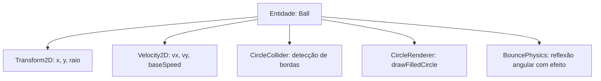
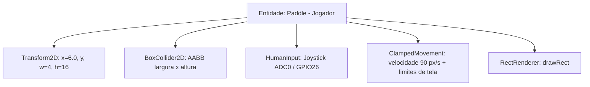
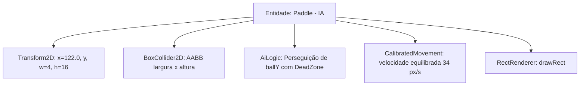

# Entidades e Seus Componentes

**Disciplina:** SMD0053 – Programação para Jogos I (2026.2)  
**Autor:** VitorCesarDC (Projeto Individual)  
**Versão:** 1.0 (Entrega do Projeto Final)  

---

## 1. Visão Geral da Arquitetura de Componentes

Na modelagem orientada a componentes (Entity-Component / ECS), uma **Entidade** é um identificador conceitual de um elemento do jogo, enquanto os **Componentes** agregam os dados de estado e comportamentos específicos (posição, física, colisão, entrada do jogador, renderização e áudio).

No projeto **Pong BitDogLab**, cada entidade do jogo é decomposta em módulos e componentes bem definidos, facilitando a manutenção, testes unitários e eliminando acoplamentos desnecessários.

---

## 2. Matriz de Entidades × Componentes

A tabela abaixo resume quais componentes compõem cada entidade do sistema:

| Componente | Bola (`Ball`) | Raquete Jogador (`Paddle Left`) | Raquete IA (`Paddle Right`) | Mediador (`GameManager`) | Efeitos (`CelebrationEffects`) |
|---|:---:|:---:|:---:|:---:|:---:|
| **Transform2D (Posição/Dimensões)** | Sim | Sim | Sim | — | — |
| **Movement / Velocidade Física** | Sim | Sim | Sim | — | — |
| **Collider (Colisão AABB / Círculo)** | Sim | Sim | Sim | — | — |
| **RenderComponent (Gráfico OLED)** | Sim | Sim | Sim | Sim (HUD/Rede) | — |
| **InputComponent (Joystick ADC)** | — | Sim (`HumanController`) | — | — | — |
| **AiLogicComponent (Rastreamento)** | — | — | Sim (`AiController`) | — | — |
| **GameState / Placar (Regras)** | — | — | — | Sim | — |
| **CollisionSolver (Árbitro)** | — | — | — | Sim | — |
| **AudioOutput (Buzzer PWM)** | — | — | — | — | Sim |
| **RgbVisualOutput (LED RGB)** | — | — | — | — | Sim |
| **NeoMatrixOutput (WS2812B PIO)** | — | — | — | — | Sim |

---

## 3. Detalhamento dos Componentes por Entidade

### 3.1. Entidade: Bola (`Ball`)

A bola é o elemento dinâmico central da partida, responsável pelo fluxo de jogo contínuo.

- **1. Transform2D:**
  - *Dados:* Posição central `(x, y)` em ponto flutuante e raio `radius_` (2.5 px).
  - *Função:* Mantém a localização espacial no plano 2D da tela.
- **2. Velocity2D & Movement:**
  - *Dados:* Vetores de velocidade `vx_`, `vy_` e velocidade base `baseSpeed_` (60.0 px/s).
  - *Função:* Desloca a posição a cada quadro através da integração: $x \leftarrow x + v_x \cdot \Delta t$, $y \leftarrow y + v_y \cdot \Delta t$.
- **3. CircleCollider:**
  - *Dados:* Raio geométrico da esfera.
  - *Função:* Fornece os limites circulares para o cálculo de intersecção com as raquetes e as paredes do campo.
- **4. CircleRenderer:**
  - *Função:* Invoca `renderer.drawFilledCircle(...)` para desenhar o corpo da bola no buffer de vídeo do display OLED.
- **5. BouncePhysics (Física de Rebatida):**
  - *Função:* Aplica o cálculo trigonométrico/offset de impacto quando atinge a raquete, transferindo efeito angular e recalculando $(v_x, v_y)$.

---

### 3.2. Entidade: Raquete do Jogador (`Paddle` - Esquerda)

Controlada diretamente pelo usuário humano via entrada analógica da BitDogLab.

- **1. Transform2D:**
  - *Dados:* Posição horizontal fixa ($x = 6.0\text{ px}$), posição vertical $y$, largura ($4.0\text{ px}$) e altura ($16.0\text{ px}$).
- **2. BoxCollider2D (AABB):**
  - *Dados:* Retângulo delimitador para checagem de sobreposição de eixos (AABB).
- **3. HumanInputComponent (`HumanController`):**
  - *Dados:* Conexão com a classe `JoystickInput` (leitura do canal ADC0 no GPIO 26).
  - *Função:* Converte a tensão analógica do potenciômetro em um valor normalizado de $[-1.0, 1.0]$ com zona morta central de 12% para eliminar ruídos de repouso.
- **4. ClampedMovement:**
  - *Função:* Aplica a velocidade de $90.0\text{ px/s}$ ao eixo $Y$ e utiliza `std::clamp` para travar a raquete dentro da altura visível da tela ($[h/2, \text{SCREEN\_HEIGHT} - h/2]$).
- **5. RectRenderer:**
  - *Função:* Desenha o corpo da raquete na tela via `renderer.drawRect(...)`.

---

### 3.3. Entidade: Raquete da IA (`Paddle` - Direita)

Utiliza rigorosamente a mesma classe `Paddle`, diferenciando-se apenas pelo componente de controle injetado.

- **1. Transform2D & BoxCollider2D:**
  - *Dados:* Idênticos à raquete do jogador, posicionada no lado oposto ($x = 122.0\text{ px}$).
- **2. AiLogicComponent (`AiController`):**
  - *Dados:* Zona morta (`deadZone_ = 5.0f`) e fator de responsividade (`responsiveness_ = 0.60f`).
  - *Função:* Compara a posição $Y$ da bola com a posição $Y$ atual da raquete. Se a diferença for superior à zona morta, comanda o deslocamento suavizado na direção da bola.
- **3. CalibratedMovement:**
  - *Função:* Velocidade configurada em $34.0\text{ px/s}$ (inferior à velocidade da bola de $60.0\text{ px/s}$), garantindo que jogadas com efeito e bolas anguladas superem a defesa da máquina.
- **4. RectRenderer:**
  - *Função:* Desenha a raquete no display OLED.

---

### 3.4. Entidade / Mediador: Gerenciador de Jogo (`GameManager`)

Atua como o árbitro e orquestrador central do jogo.

- **1. GameStateComponent:**
  - *Dados:* Enum `GameState` (`Menu`, `Playing`, `PointScored`, `GameOver`).
  - *Função:* Controla o fluxo de execução global da partida.
- **2. ScoreboardComponent:**
  - *Dados:* `scoreLeft_`, `scoreRight_` e constante `WINNING_SCORE = 5`.
  - *Função:* Contabiliza os pontos de cada lado e detecta quando a condição de vitória é alcançada.
- **3. StreakTrackerComponent (Hat-Trick):**
  - *Dados:* `lastScorerSide_` e contador `streak_`.
  - *Função:* Rastreia se o mesmo competidor marcou 3 gols seguidos para disparar efeitos especiais de comemoração.
- **4. CollisionSystemComponent:**
  - *Função:* Realiza os testes de intersecção geométrica entre a bola e as paredes (superior/inferior) e entre a bola e as raquetes.
- **5. HUDVisualComponent:**
  - *Função:* Renderiza no display OLED a linha central pontilhada (rede da quadra) e os marcadores de pontuação de cada jogador no topo da tela.

---

### 3.5. Módulo de Atuadores: Efeitos Audiovisuais (`CelebrationEffects`)

Concentra todo o controle de atuadores físicos da BitDogLab em resposta aos eventos do jogo.

- **1. BuzzerAudioComponent (`BuzzerOutput`):**
  - *Hardware:* GPIO 21 configurado com PWM de frequência e duty cycle variáveis.
  - *Função:* Gera tons musicais sintetizados, beeps de colisão e fanfarras melódicas.
- **2. RgbLedColorComponent (`RgbLedOutput`):**
  - *Hardware:* GPIOs 13 (R), 11 (G) e 12 (B) com PWM de 8 bits (0 a 255).
  - *Função:* Sinalização visual instantânea de gols (azul para jogador, vermelho para adversário, roxo/laranja para sequências).
- **3. NeoMatrixAnimationComponent (`NeoMatrixOutput`):**
  - *Hardware:* GPIO 7 conectado à matriz 5×5 de LEDs WS2812B controlada via máquina de estados PIO (*Programmable I/O*).
  - *Função:* Executa animações gráficas de onda verde em caso de vitória e fade-out vermelho em caso de derrota.

---

## 4. Justificativa de Engenharia e Escolha dos Componentes

1. **Por que desacoplar Entrada (`IPaddleController`) de Movimento (`Paddle`)?**
   - Permite que a física e as dimensões da raquete sejam compartilhadas entre jogador humano e IA sem duplicação de linhas de código.
2. **Por que separar Renderização (`IRenderer`) das Entidades?**
   - Garante que a lógica física do jogo possa ser executada ou testada independentemente do hardware de display específico (permitindo trocar o display OLED SSD1306 por qualquer outro sem alterar a bola ou a raquete).
3. **Por que centralizar os Efeitos em `CelebrationEffects`?**
   - Permite que tanto o jogo oficial (`pong_bitdoglab`) quanto o executável de diagnóstico (`pong_test_menu`) compartilhem as mesmas frequências e cores sem duplicar tabelas de notas musicais ou rotinas de PWM.
