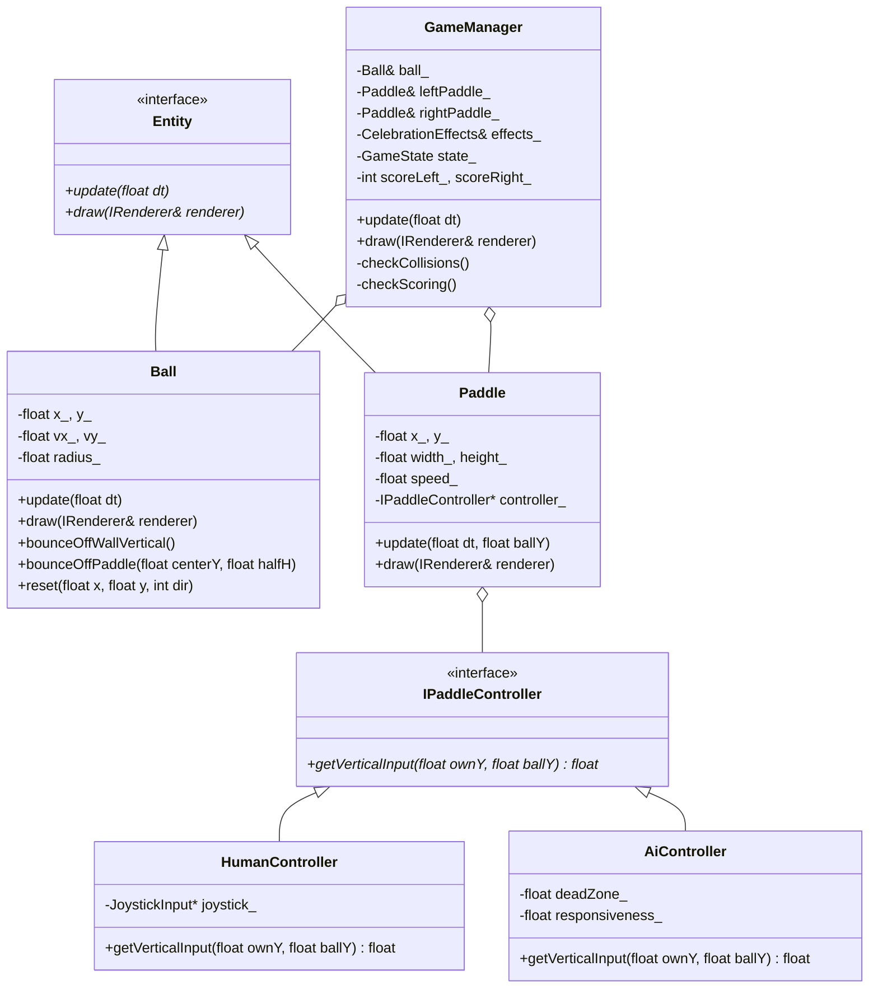

# Entidades do Jogo (Revisado)

**Disciplina:** SMD0053 – Programação para Jogos I (2026.2)  
**Autor:** VitorCesarDC (Projeto Individual)  
**Versão:** 1.0 (Revisão Pós-Apresentação)  

---

## 1. Identificação e Lista de Entidades

No projeto do Pong para BitDogLab, distinguimos entidades ativas de jogo (que possuem ciclo de atualização e movimento), mediadores lógicos e atuadores de hardware:

| Entidade / Módulo | Tipo de Elemento | Responsabilidade Principal |
|---|---|---|
| **`Ball` (Bola)** | Entidade de Jogo (`Entity`) | Movimenta-se continuamente no espaço 2D, processa velocidade linear e reflete sua trajetória quando notificada de colisões. |
| **`Paddle` (Raquete Esquerda)** | Entidade de Jogo (`Entity`) | Raquete controlada pelo jogador através do joystick analógico. Limitada às bordas da tela. |
| **`Paddle` (Raquete Direita)** | Entidade de Jogo (`Entity`) | Raquete controlada pelo algoritmo de IA (perseguição vertical). Utiliza exatamente a mesma classe `Paddle`. |
| **`GameManager`** | Mediador / Árbitro | Orquestra as colisões entre entidades, gerencia o placar, dita a máquina de estados e dispara os efeitos sonoros e visuais. |
| **Placar / HUD** | Dado de Estado | Informação mantida no `GameManager` e renderizada na tela como elemento gráfico (não necessita ser uma classe `Entity` independente). |
| **`CelebrationEffects` / HAL** | Atuadores / Efeitos | Módulo reativo acionado por eventos (colisão, gol, hat-trick, fim de jogo) para controlar buzzer, LED RGB e matriz de LEDs WS2812B. |

---

## 2. Respostas às 7 Perguntas Conceituais de Modelagem

### 1. O que se move, muda de estado ou reage a algo?
- **`Ball`:** Move-se a cada quadro somando $(v_x \cdot \Delta t, v_y \cdot \Delta t)$ e inverte a direção ao colidir com superfícies.
- **`Paddle` (Esquerda e Direita):** Move-se verticalmente no eixo $Y$ de acordo com o sinal fornecido pelo seu respectivo controlador (`IPaddleController`).
- **`GameManager`:** Transita entre os estados do jogo (`Menu` $\rightarrow$ `Playing` $\rightarrow$ `PointScored` $\rightarrow$ `GameOver`) e reage a eventos globais da partida.

### 2. O que cada entidade sabe sobre si (propriedades e estado interno)?
- **`Ball`:** Posição $(x, y)$, velocidade $(v_x, v_y)$, raio ($r$), velocidade base escalar.
- **`Paddle`:** Posição $(x, y)$, largura ($w$), altura ($h$), velocidade máxima escalar, limites verticais de tela e ponteiro para a estratégia de controle (`IPaddleController*`).
- **`GameManager`:** Estado atual (`GameState`), placar esquerdo e direito, dimensões da tela, histórico de sequência de gols (`streak_`) e referências às instâncias de `Ball`, `leftPaddle`, `rightPaddle` e `CelebrationEffects`.

### 3. O que cada entidade faz a cada quadro (comportamento no `update`)?
- **`Ball::update(dt)`:** Atualiza suas coordenadas $(x, y)$. Não toma decisões sobre colisões ou saídas de tela por conta própria.
- **`Paddle::update(dt, ballY)`:** Consulta seu controlador para obter o input vertical normalizado $[-1.0, 1.0]$, calcula o deslocamento e aplica `std::clamp` para não ultrapassar o teto ou o chão.
- **`GameManager::update(dt)`:** Executa a atualização de todas as entidades filhas, calcula interseções de caixas delimitadoras (AABB e círculo), detecta gols e aciona o módulo de efeitos.

### 4. O que colide com o quê? A reação é igual para todo par?
**Não, a reação é estritamente diferente para cada par de interação:**
- **Bola × Parede (Topo/Base):** Colisão física simples que inverte apenas a velocidade vertical ($v_y = -v_y$) e toca um beep suave de 15 ms.
- **Bola × Raquete:** Colisão elástica com aplicação de "efeito": inverte a velocidade horizontal ($v_x = -v_x$) e recalcula $v_y$ proporcionalmente à distância entre o centro da raquete e o ponto de impacto.
- **Bola × Borda Lateral (Fora da Raquete):** **Não é colisão física.** É um evento de pontuação que paralisa a rodada, pontua para o adversário correspondente e reseta a bola no centro da quadra.

### 5. Uma entidade aciona ou lê a outra diretamente ou por um terceiro?
- **Por um terceiro:** O `GameManager` atua como **Mediador**. A `Ball` e a `Paddle` não mantêm ponteiros nem conhecimento mútuo. O `GameManager` calcula a colisão e invoca `ball.bounceOffPaddle(...)`.
- **Exceção de entrada:** A IA necessita saber a coordenada $Y$ da bola. Essa informação é injetada como argumento no método `Paddle::update(dt, ballY)`, evitando que a raquete precise acoplar ou armazenar uma instância da `Ball`.

### 6. Algo parece entidade, mas não se atualiza sozinho?
- **Placar e Linha Central (HUD):** São dados de partida desenhados diretamente pelo renderer a partir das variáveis do `GameManager`.
- **Buzzer, LED RGB e Matriz 5x5:** São atuadores de saída reativos. Não possuem lógica física quadro a quadro (`update`); apenas recebem pulsos e comandos quando um evento relevante ocorre.

### 7. Duas coisas repetem o mesmo comportamento?
- **Raquetes Esquerda e Direita:** São a **mesma classe `Paddle`**. A variação de comportamento (controle por jogador humano via ADC ou controle por IA) é resolvida pelo padrão de projeto **Strategy** (`IPaddleController`). Isso elimina qualquer código duplicado de física, desenho ou colisão.

---

## 3. Diagrama de Relacionamento das Entidades

