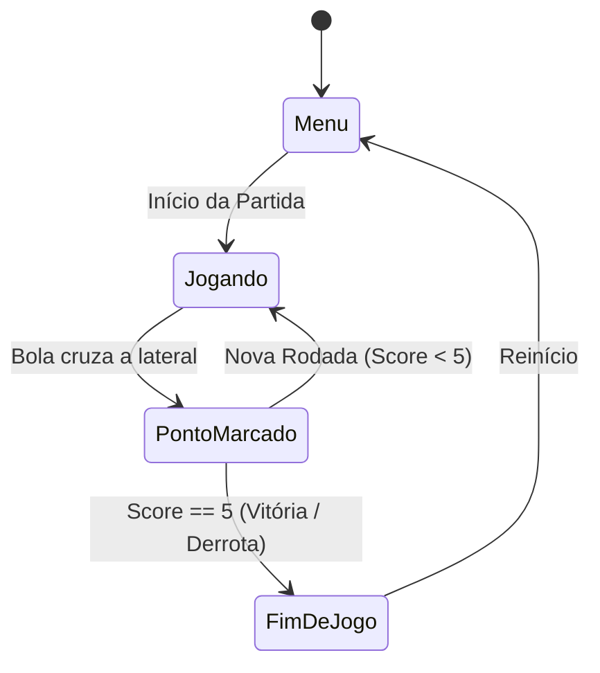

# SGDD — Pong BitDogLab (Game Design Document Sintético)

**Disciplina:** SMD0053 – Programação para Jogos I (2026.2)  
**Autor:** VitorCesarDC (Projeto Individual)  
**Versão:** 1.0 (Versão Final de Entrega)  
**Hardware Alvo:** Placa BitDogLab v6.3 (Raspberry Pi Pico / RP2040)  

---

## 1. Visão Geral do Jogo

| Parâmetro | Detalhes |
|---|---|
| **Título** | Pong BitDogLab |
| **Gênero** | Arcade / Retrô / Esporte 2D |
| **Público-alvo** | Jogadores casuais, entusiastas de hardware embarcado e jogos clássicos |
| **Plataforma** | Placa Didática BitDogLab v6.3 (Display OLED 128x64 SSD1306, Joystick, Buzzer, LED RGB e Matriz WS2812 5x5) |
| **Linguagem & SDK** | C++17 com Raspberry Pi Pico SDK |
| **Modo de Jogo** | 1 Jogador (Humano) contra Computador (IA Reativa) |
| **High Concept** | Uma recriação fiel do clássico Pong em sistema embarcado, potencializada por respostas audiovisuais em tempo real (luzes, cores e tons musicais a cada evento de partida). |

---

## 2. Objetivo e Condições de Vitória

- **Objetivo do Jogador:** Controlar a raquete esquerda para rebater a bola de volta ao campo adversário, impedindo que ela passe pela linha lateral esquerda e tentando fazê-la ultrapassar a raquete direita (IA).
- **Pontuação:** Cada vez que a bola cruza a borda lateral do oponente, o jogador marca **+1 ponto**.
- **Condição de Vitória:** O primeiro competidor (Jogador ou IA) a atingir **5 pontos** encerra a partida como vencedor.

---

## 3. Controles e Entradas

| Dispositivo de Entrada | Mapeamento no Hardware | Ação no Jogo |
|---|---|---|
| **Joystick Analógico (VRy)** | GPIO 26 (ADC0) | Move a raquete esquerda para cima ou para baixo com velocidade proporcional |
| **Botão A** | GPIO 5 (Pull-up) | Confirmação no menu de testes e reinício |
| **Botão B (Opcional)** | GPIO 6 (Pull-up) | Pausa/Funções auxiliares |

---

## 4. Mecânicas Principais do Jogo

1. **Movimento da Bola:** 
   - Move-se continuamente em um espaço 2D com vetor de velocidade (vx, vy) e velocidade base calibrada.
2. **Colisão com Paredes Superior e Inferior:** 
   - Inverte a componente vertical da velocidade (vy = -vy) e dispara feedback sonoro suave no buzzer.
3. **Colisão com as Raquetes (Cálculo de Efeito):** 
   - Inverte a velocidade horizontal (vx = -vx).
   - O ponto de impacto relativo na raquete (offset do centro) altera o ângulo e o módulo de vy, permitindo "cortadas" e variações angulares estratégicas.
4. **Evento de Gol / Saída Lateral:** 
   - A saída da bola pela lateral não é tratada como colisão, mas como evento de pontuação: incrementa o placar correspondente, reseta a posição da bola no centro da quadra e dispara as comemorações.
5. **Inteligência Artificial (IA Adaptada):** 
   - A raquete direita persegue a posição Y da bola com zona morta anti-tremulação e velocidade ajustada (34 px/s vs 90 px/s do jogador), permitindo partidas equilibradas e desafiadoras.
6. **Mecânica de Sequência (Hat-Trick):** 
   - Se o mesmo lado marcar 3 gols consecutivos sem sofrer nenhum gol intermediário, um efeito especial de *Hat-Trick* é disparado.

---

## 5. Máquina de Estados do Jogo

| Estado | Descrição |
|---|---|
| **Menu** | Tela de espera e seleção inicial ou menu de testes de periféricos. |
| **Jogando (Playing)** | Entidades em movimento contínuo a 60 FPS com física em passo fixo. |
| **PontoMarcado (PointScored)** | Interrupção da rodada, execução do feedback audiovisual de gol/hat-trick e reposicionamento da bola. |
| **FimDeJogo (GameOver)** | Exibição de vitória ou derrota com animação completa na matriz de LEDs e retorno ao estado inicial. |

---

## 6. Feedback Audiovisual (Hardware HAL)

O jogo utiliza todos os periféricos de saída da BitDogLab para criar uma experiência sensorial completa:

| Evento | LED RGB (GPIO 11/12/13) | Buzzer Passivo (GPIO 21) | Matriz NeoPixel 5x5 (GPIO 7) |
|---|---|---|---|
| **Colisão (Parede/Raquete)** | Desligado | Beep curto e suave (900 Hz, 15ms) | Desligada |
| **Gol do Jogador** | Azul fixo | Chirp ascendente (E5 → G5) | Desligada |
| **Gol do Adversário** | Vermelho fixo | Chirp descendente (A4 → F4) | Desligada |
| **Hat-Trick Jogador** | Roxo piscando 3x | Fanfarra ascendente (C5-E5-G5-C6) | Desligada |
| **Hat-Trick Adversário** | Laranja piscando 3x | Melodia descendente (C5-A4-F4-D4) | Desligada |
| **Vitória** | Verde | Melodia alegre de 5 notas | Varredura em onda verde + Flash |
| **Derrota** | Vermelho | Melodia triste descendente | Varredura apagando em vermelho |

---

## 7. Interface Gráfica (Display OLED SSD1306)

- **Resolução:** 128 × 64 pixels monocromático via I2C (GPIO 14 / GPIO 15).
- **Elementos em tela:**
  - Raquete do jogador (esquerda) e da IA (direita);
  - Bola circular com diâmetro calibrado;
  - Rede pontilhada central divisória;
  - Marcadores visuais de pontuação no topo da tela.

---

## 8. Escopo do Projeto

- **Dentro do Escopo:**
  - Simulação física 2D determinística em 60 FPS;
  - Controlador humano via ADC analógico e IA reativa;
  - Feedback sonoro com PWM e visual com LED RGB e matriz de LEDs WS2812B;
  - Menu de diagnóstico integrado (`pong_test_menu`).
- **Fora do Escopo:**
  - Conexão Wi-Fi/Bluetooth ou multiplayer online;
  - Persistência em memória Flash externa.
